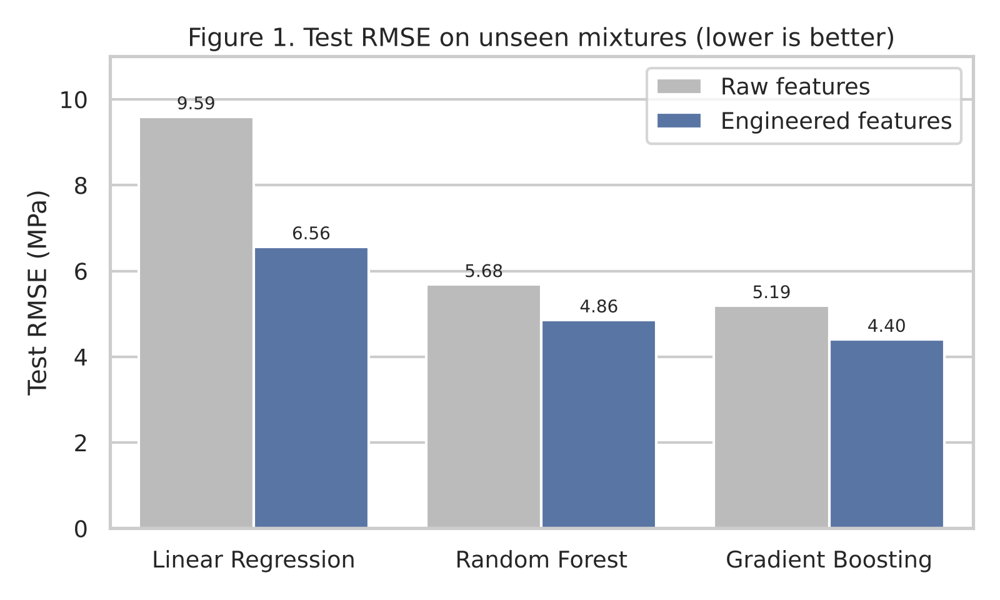
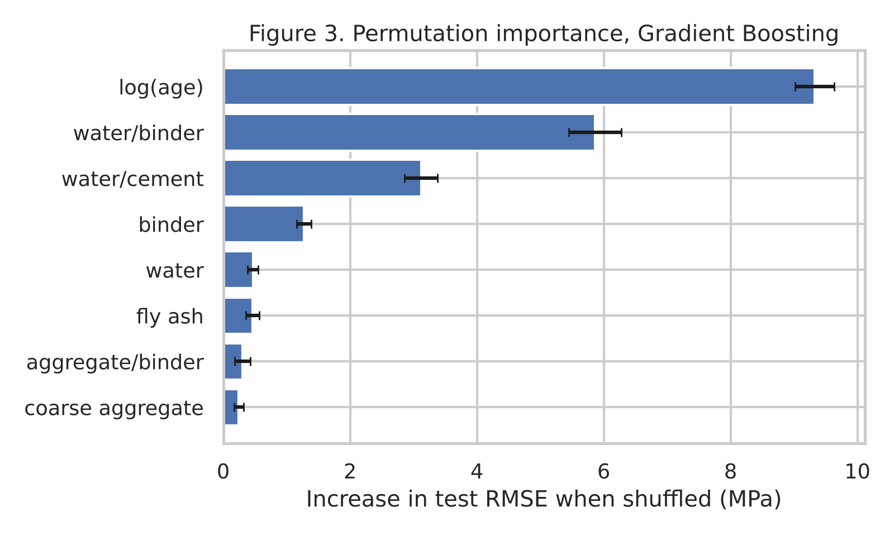
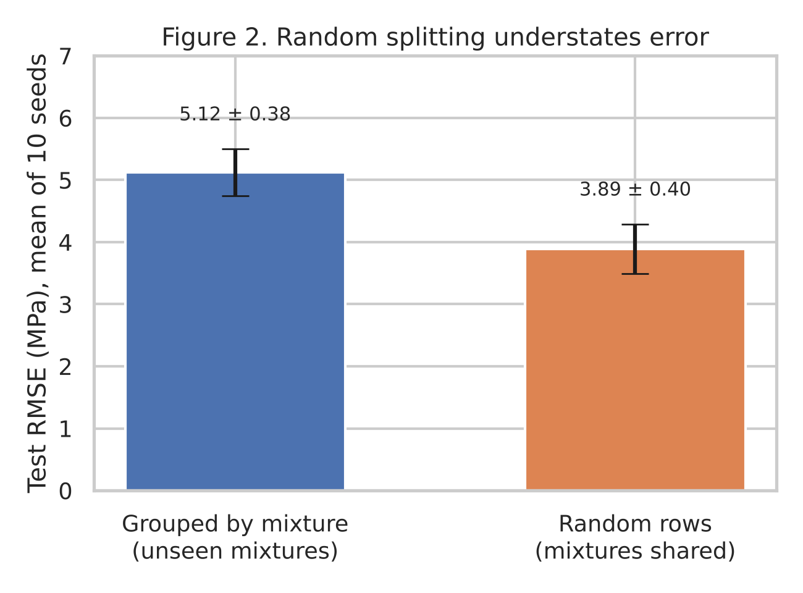

# Predicting Concrete Compressive Strength for Unseen Mixtures: Tree Ensembles, Ratio Features, and the Cost of Random Splitting

**Author:** Mohiminul Islam Fardin
**Date:** October 2026
**Repository files:** [`experiment.ipynb`](experiment.ipynb) · [`methodology.md`](methodology.md) · [`literature_review.md`](literature_review.md) · [`slides.pptx`](slides.pptx)

---

## Abstract

This study examined how accurately the compressive strength of concrete can be predicted from mix proportions and curing age when the mixture has not been seen during training. The UCI Concrete Compressive Strength dataset (1,030 tests) was cleaned to 996 mixture–age records across 428 distinct mixtures. Linear Regression, Random Forest, and Gradient Boosting models were trained on raw ingredient quantities and on an engineered set adding water-to-binder, water-to-cement, and log-age features. Models were tuned with grouped cross-validation and tested on 86 held-out mixtures, and a random row split was run as a leakage comparison over ten seeds. Gradient Boosting with engineered features performed best (RMSE 4.40 MPa, MAE 3.15 MPa, R² 0.926), and engineered features improved every model, reducing the linear baseline's RMSE from 9.59 to 6.56 MPa. Log-age and the water-to-binder ratio were the most important predictors, consistent with Abrams' law and hydration kinetics. A random split understated the error for new mixtures by about one quarter (mean RMSE 3.89 versus 5.12 MPa), indicating that grouped evaluation gives the more realistic estimate for mix-design use.

**Keywords:** concrete compressive strength; machine learning; gradient boosting; feature engineering; data leakage

---

## 1. Introduction

Compressive strength is the property most often used to specify and accept structural concrete, yet it is normally confirmed only after 28 days of curing. A model that estimates strength from the mix design alone would allow engineers to screen candidate mixtures before casting, reduce trial batches, and support cost- and carbon-aware mix optimisation.

Machine learning has been applied to this problem for more than two decades. Yeh (1998) compiled laboratory results for high-performance concrete and showed that a neural network predicted strength better than regression, and that the trained network could serve as a virtual laboratory for testing changes to individual ingredients. Later work moved towards ensembles. Chou et al. (2014) compared single learners with voting, bagging, and stacking ensembles on multi-country data and concluded that ensembles are efficient and practical tools for strength simulation. Feng et al. (2020) applied AdaBoost with decision-tree learners to the same 1,030 records used here and reported a cross-validated R² above 0.95, ahead of neural network and support vector models. Nguyen et al. (2021) likewise found that gradient boosting and XGBoost gave the best accuracy among four tuned learners while remaining fast to train. Young et al. (2019) widened the perspective by analysing more than 10,000 job-site mixtures, showing that results from small laboratory datasets do not transfer automatically to field concrete.

Two gaps follow from this literature. First, most studies split the Yeh dataset at random, although the same mixture is tested at several curing ages; a random split can therefore place one age of a mixture in training and another in testing, which inflates accuracy. Second, the contribution of physically motivated ratio features, as opposed to model choice, is rarely isolated.

This paper therefore asks: **how accurately can compressive strength be predicted for mixtures the model has never seen, and do tree ensembles with domain-informed ratio features outperform a linear baseline?** Two supporting questions are addressed: whether engineered ratio features improve accuracy over raw quantities (RQ-a), and how much a random split overstates accuracy relative to a split grouped by mixture (RQ-b).

## 2. Methodology

The full design is documented in [`methodology.md`](methodology.md) and implemented in [`experiment.ipynb`](experiment.ipynb).

**Data.** The UCI Concrete Compressive Strength dataset (Yeh, 1998) contains 1,030 laboratory tests with eight numeric inputs (cement, blast furnace slag, fly ash, water, superplasticizer, coarse aggregate, fine aggregate, all in kg/m³, and age in days) and compressive strength in MPa as the target. There are no missing values.

**Cleaning.** Column names were shortened. Zeros in slag, fly ash, and superplasticizer were retained as genuine values meaning that the ingredient was not used. Twenty-five exact duplicate rows were removed, and replicate tests of the same mixture at the same age were averaged, leaving 996 records. Statistical outliers (1.5 × IQR rule) were flagged but kept because they represent physically valid high-strength mixes and long-term tests. Each unique combination of the seven ingredient quantities received a mixture ID, giving 428 distinct mixtures (2.33 tests per mixture on average).

**Feature engineering.** Eight features grounded in concrete technology were added: total binder, water-to-cement ratio, water-to-binder ratio, supplementary cementitious fraction, superplasticizer-to-binder ratio, aggregate-to-binder ratio, fine-aggregate fraction, and the natural logarithm of age. Two feature sets were compared: *raw* (eight original inputs) and *engineered* (seven ingredients plus the eight derived features, 15 in total).

**Models.** Three models were fitted to each feature set: Linear Regression with standardised inputs as a transparent baseline, a Random Forest Regressor, and a Gradient Boosting Regressor. The two ensembles were tuned with a randomised search of 20 candidates using five-fold `GroupKFold` cross-validation on the training data only.

**Evaluation.** A `GroupShuffleSplit` held out 20% of mixtures (86 mixtures, 195 records) as the test set, so that every test mixture was unseen during training (random seed 42). RMSE in MPa was the primary metric, with MAE and R² as secondary metrics. Residuals were examined by curing-age band, and permutation importance was computed on the test set for the best model. For RQ-b, the best configuration was refitted under both a grouped and a random 80/20 split across ten seeds.

## 3. Results

### 3.1 Model comparison

Table 1 reports test-set performance on the 86 held-out mixtures, and Figure 1 shows the RMSE comparison.

**Table 1.** Test-set performance on unseen mixtures (n = 195 records), sorted by RMSE.

| Model | Feature set | RMSE (MPa) | MAE (MPa) | R² |
|---|---|---:|---:|---:|
| Gradient Boosting | Engineered | **4.40** | **3.15** | **0.926** |
| Random Forest | Engineered | 4.86 | 3.57 | 0.910 |
| Gradient Boosting | Raw | 5.19 | 3.68 | 0.897 |
| Random Forest | Raw | 5.68 | 4.38 | 0.876 |
| Linear Regression | Engineered | 6.56 | 5.29 | 0.835 |
| Linear Regression | Raw | 9.59 | 7.52 | 0.647 |

Gradient Boosting with engineered features was the most accurate model, followed by Random Forest with engineered features. Both ensembles clearly outperformed the linear baseline. Grouped cross-validation on the training data ranked the models in the same order (CV RMSE 5.20, 5.81, and 7.34 MPa for the engineered Gradient Boosting, Random Forest, and Linear Regression models respectively).

### 3.2 Effect of feature engineering (RQ-a)

Engineered features reduced test RMSE for every model: by 3.03 MPa (32%) for Linear Regression, 0.83 MPa (15%) for Random Forest, and 0.79 MPa (15%) for Gradient Boosting. Figure 3 shows that the three most important predictors in the best model were log-age, the water-to-binder ratio, and the water-to-cement ratio, all engineered features. Errors were spread evenly across curing ages, with RMSE between 4.2 and 5.1 MPa in each age band and mean residuals within ±0.6 MPa.

### 3.3 Grouped versus random splitting (RQ-b)

Under a random row split, 105 of 155 test mixtures also appeared in the training data. Table 2 and Figure 2 summarise the ten-seed comparison.

**Table 2.** Test RMSE of the best configuration under two splitting schemes, ten seeds.

| Split | Mean RMSE (MPa) | SD | Min | Max |
|---|---:|---:|---:|---:|
| Grouped by mixture | 5.12 | 0.38 | 4.58 | 5.82 |
| Random rows | 3.89 | 0.40 | 3.36 | 4.59 |

The random split produced a mean RMSE 1.23 MPa lower than the grouped split, and the two ranges barely overlapped.

## 4. Discussion

The results confirm the pattern reported in the literature that nonlinear tree ensembles outperform linear models on mix-design data (Chou et al., 2014; Feng et al., 2020; Nguyen et al., 2021), with gradient boosting again the strongest learner. The more informative finding is that feature engineering mattered almost as much as model choice. Ratio features cut the linear model's error by a third and still improved both ensembles by about 15%, even though trees can in principle learn such interactions on their own. The importance ranking is consistent with established concrete science: strength falls as the water-to-binder ratio rises (Abrams' law) and grows approximately logarithmically with curing age as hydration proceeds. This agreement suggests that the model is learning physically meaningful relationships rather than artefacts of the dataset.

The leakage check shows why evaluation design deserves as much attention as algorithm selection. Because most mixtures appear at several ages, a random split lets the model see the same recipe during training and testing. The resulting error estimate was about 24% too optimistic. High R² values reported under random splits, including those above 0.95, should therefore be read as performance on familiar mixtures rather than on new designs. For an engineer screening a genuinely new mix, an error of roughly 5 MPa is the more realistic expectation, which is still useful for preliminary screening but not sufficient to replace confirmation testing.

**Limitations.** First, the data come from a single laboratory compilation; as Young et al. (2019) show, field concrete is subject to variability in materials, placement, and curing that these records do not capture, so external validity is unproven. Second, important explanatory variables are absent, including cement type, aggregate type and size, admixture chemistry, curing temperature and humidity, and specimen geometry. Third, very early and very late ages are sparsely represented, so predictions there carry greater uncertainty. Fourth, the dataset is small (428 mixtures), which constrained hyperparameter tuning; only 20 candidates were searched per model. Fifth, replicate tests were averaged even where they disagreed sharply (one pair differs by 33 MPa at 7 days), which may hide recording errors. Finally, the models provide point estimates only, whereas design decisions require a dependable lower bound on strength.

## 5. Conclusion

This study showed that the compressive strength of concrete can be predicted for unseen mixtures with an RMSE of 4.40 MPa and an R² of 0.926 using Gradient Boosting with engineered ratio and log-age features, clearly ahead of a linear baseline. Domain-informed features improved every model and produced importance rankings consistent with Abrams' law and hydration kinetics, which supports the physical credibility of the model. Evaluating on whole held-out mixtures proved essential: a random split understated the error by about a quarter, so studies that split this dataset at random likely overstate accuracy for practical mix design. Future work should add prediction intervals through quantile regression or conformal prediction, test monotonic-constrained boosting, and validate the model on an external job-site dataset before any operational use.

## References

Chou, J.-S., Tsai, C.-F., Pham, A.-D., & Lu, Y.-H. (2014). Machine learning in concrete strength simulations: Multi-nation data analytics. *Construction and Building Materials*, *73*, 771–780. https://doi.org/10.1016/j.conbuildmat.2014.09.054

Feng, D.-C., Liu, Z.-T., Wang, X.-D., Chen, Y., Chang, J.-Q., Wei, D.-F., & Jiang, Z.-M. (2020). Machine learning-based compressive strength prediction for concrete: An adaptive boosting approach. *Construction and Building Materials*, *230*, 117000. https://doi.org/10.1016/j.conbuildmat.2019.117000

Nguyen, H., Vu, T., Vo, T. P., & Thai, H.-T. (2021). Efficient machine learning models for prediction of concrete strengths. *Construction and Building Materials*, *266*, 120950. https://doi.org/10.1016/j.conbuildmat.2020.120950

Yeh, I.-C. (1998). Modeling of strength of high-performance concrete using artificial neural networks. *Cement and Concrete Research*, *28*(12), 1797–1808. https://doi.org/10.1016/S0008-8846(98)00165-3

Young, B. A., Hall, A., Pilon, L., Gupta, P., & Sant, G. (2019). Can the compressive strength of concrete be estimated from knowledge of the mixture proportions?: New insights from statistical analysis and machine learning methods. *Cement and Concrete Research*, *115*, 379–388. https://doi.org/10.1016/j.cemconres.2018.09.006

*References formatted in APA 7th edition. The Zotero-importable library is in [`references.bib`](references.bib).*
